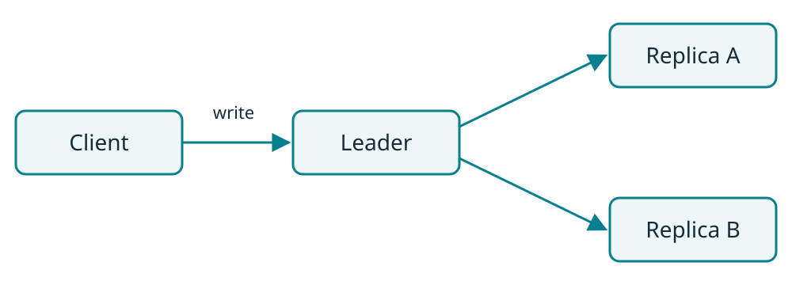

<!-- _class: cover -->
<!-- _paginate: false -->

# 登壇タイトル

話の内容や、聴衆が持ち帰れることを一文で伝える

登壇者名 / イベント名 / YYYY-MM-DD

---

# 自己紹介

名前と、今日のテーマに関係する経験を短く紹介する。

GitHub: [@ユーザー名](https://github.com/username)

---

<!-- _class: statement -->

# 今日、持ち帰ってほしいこと

**発表の結論を一文で書く。**

---

<!-- _class: section -->

# 課題と前提

---

# どんな場面で困るのか

システムや利用者が置かれている状況を、具体的な場面から説明する。

今回扱う範囲と前提条件をここに加える。背景説明が必要なら、情報量に合わせてページを分ける。

---

<!-- _class: figure -->

# 書き込みはどこを通るか



図の中で伝えたい経路や役割を、短く説明する。

---

# 書き込み処理の要点

```go
func handleWrite(ctx context.Context, req Request) error {
    if err := validate(req); err != nil {
        return err
    }
    return store.Put(ctx, req.Key, req.Value)
}
```

この例では、保存前に入力を検証する。実際のコードでは、説明したい箇所に絞って載せ、判断の理由や動作を言葉で補う。

---

# 選択肢をどう比べるか

| 観点 | 案A | 案B |
| --- | --- | --- |
| 書き込み経路 | Leaderに集約 | 各ノードに分散 |
| 一貫性 | 強い | 結果整合性 |
| 運用上の注意 | Leaderの切替 | 競合の解決 |

発表で扱う案と観点に差し替える。違いが少ない場合は、表ではなく文章や図で説明する。

---

# 遅延が増える条件

書き込みが特定のノードに集中すると、そのノードの処理待ちが長くなる。複製先への転送や応答待ちも、書き込み時間に加わる。

利用者から見える遅延は、処理時間だけでは決まらない。どこで待ちが発生するかを図や計測値で示し、原因と影響を結び付けて説明する。

---

<!-- _class: statement -->

# まとめ

**課題に対して何を選び、なぜそうしたのか。**

聴衆が次に試せることを一文で添える。

---

<!-- _class: references -->

# 参考資料・補足

- 関連する仕様・公式ドキュメント
- 実装や検証データへのリンク
- 発表中に省略した前提や制約
